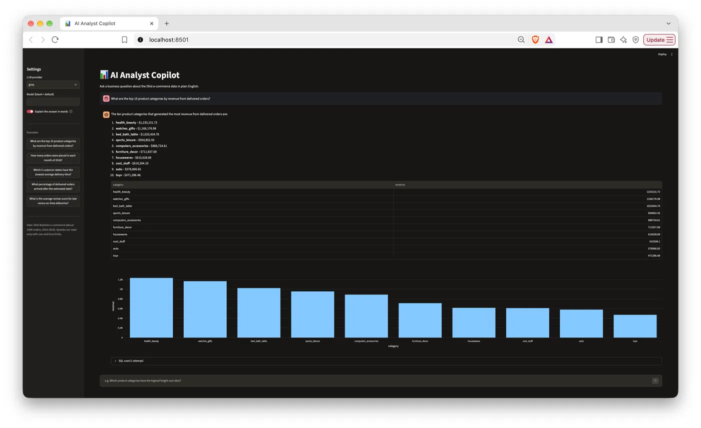
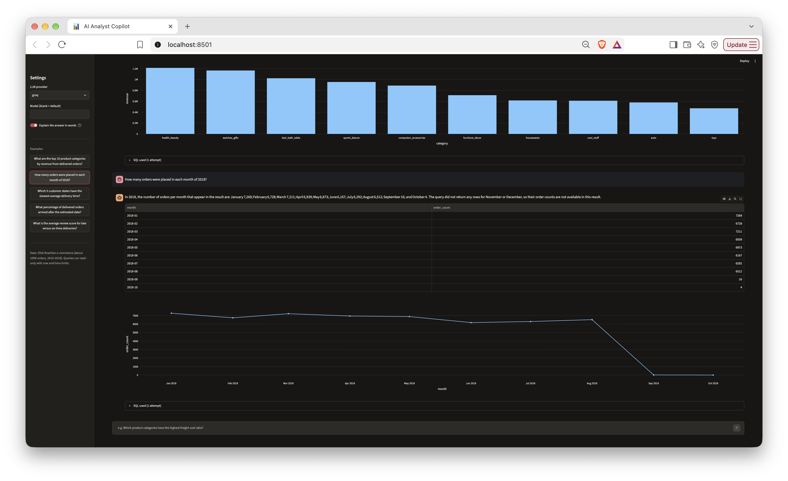

# AI Analyst Copilot

Ask business questions in plain English and get the SQL, a result table, a chart and a short written answer.
Built on the [Olist Brazilian e-commerce dataset](https://www.kaggle.com/datasets/olistbr/brazilian-ecommerce)
(about 100K orders, 2016-2018, 8 linked tables).




*Data ends Oct 2018, so the last two months in the line chart are partial.*

```
question -> schema + business notes + question -> LLM writes SQL -> guardrails -> SQLite (read-only)
        -> table + auto chart + plain-English explanation        (query fails? error goes back to the LLM, up to 2 retries)
```

## Quick start
The Olist data is not included in this repo. Download the [dataset](https://www.kaggle.com/datasets/olistbr/brazilian-ecommerce) from Kaggle and put the 8 CSVs in `data/raw/`.

```bash
pip install -r requirements.txt
cp .env.example .env            # add your free Groq key from console.groq.com
python load_olist.py            # builds data/olist.db from data/raw/*.csv (about 20 s)
streamlit run app.py
```
In `.env`, set `PROVIDER=groq`, `GROQ_API_KEY=...` and `GROQ_MODEL=openai/gpt-oss-120b`.
Gemini (`PROVIDER=gemini`) and OpenRouter (`PROVIDER=openrouter`) are also supported (see `.env.example`).

## Guardrails
Every query passes three layers before it touches data:
1. **Text check**: strips comments, allows exactly one `SELECT`/`WITH` statement.
2. **Read-only connection** (`mode=ro`) plus a **SQLite authorizer** that denies everything except reads (blocks DROP, DELETE, UPDATE, INSERT, PRAGMA, ATTACH, CREATE).
3. **Limits**: results capped at 1,000 rows, queries stopped after 10 seconds.

Blocked queries are never "retried around" by the LLM. Tests: `python -m unittest discover -s tests -v`.

## Evaluation
`eval/questions_olist.json` has 45 questions (12 easy, 20 medium, 13 hard) with hand-written gold SQL that has been
run against the database. Answers are compared by result (not SQL text): tolerant to column names/order and
rounding at the gold precision, strict on values, and on row order for top-N questions.

```bash
python eval.py --provider groq              # full run; resumes if interrupted
python eval.py --provider groq --limit 10   # quick check
python eval.py --fresh                      # ignore the cache and rerun everything
```
Results are saved per model in `eval/results/`. Metrics: executes on the first try, correct on the first try,
correct after retry, split by difficulty.

**Results** (GPT-OSS 120B via Groq, 45 questions, single run each):

| Run | Correct 1st try | Correct after retry | Easy | Medium | Hard (1st try) |
|---|---|---|---|---|---|
| Baseline | 86.7% (39/45) | 86.7% (39/45) | 100% | 85.0% | 76.9% |
| After notes fix | 95.6% (43/45) | 97.8% (44/45) | 100% | 100% | 84.6% |

**What happened between the two runs.** The baseline had 6 misses. Five (q20, q26, q39, q40, q41) came from the
model adding an unrequested "delivered orders only" filter, which an over-broad rule in the business notes had
encouraged. The sixth (q15) returned the year as a number instead of text; this did not recur in the second run,
so it was most likely run-to-run variation. I tightened the rule in `data/olist.notes.md` and reran all 45
questions.

**Caveats.** The fix was made after inspecting failures on these same 45 questions, so the second row is an upper
bound and the baseline is the untuned figure. Results are from a single run per setting and can shift by a question
or two between runs. The one remaining miss (q33) is ambiguous: "highest revenue growth" can mean absolute or
percentage change, and the model chose percentage. The retry loop fixed one question (q38) that failed to execute
on the first try.

## Design choices worth knowing
- **Business notes** (`data/olist.notes.md`) are given to the LLM: revenue = item price, text timestamps,
  one-to-many joins that cause double counting, and a rule to filter on delivered orders only when the question asks
  for it. Most wrong answers on this dataset come from these definitions, not from SQL syntax. One over-broad rule
  here cost about 9 points of accuracy in the baseline run.
- **Caching + throttling**: every LLM response is cached on disk and calls are spaced out, so re-runs cost nothing and free-tier limits are respected.
- **Provider-agnostic**: one small interface, so models can be compared on the same questions.

## Limitations
- Single-turn questions (no follow-ups like "now only for 2018").
- Evaluation uses 45 questions on one dataset; accuracy on other schemas will differ.
- A correct-looking answer can still use the wrong definition (e.g. revenue with or without freight); the SQL is always shown for that reason.

## Deploy (Streamlit Community Cloud)
The Olist data is not in this repo, so add the 8 CSVs (or the `.csv.gz` versions) to `data/raw/` before deploying; `data/olist.db` is git-ignored and rebuilt on first start. Then create the app from the repo and add your key under Settings -> Secrets:

```
GROQ_API_KEY = "your-groq-key"
```

Data: Olist, via Kaggle, CC BY-NC-SA 4.0.
